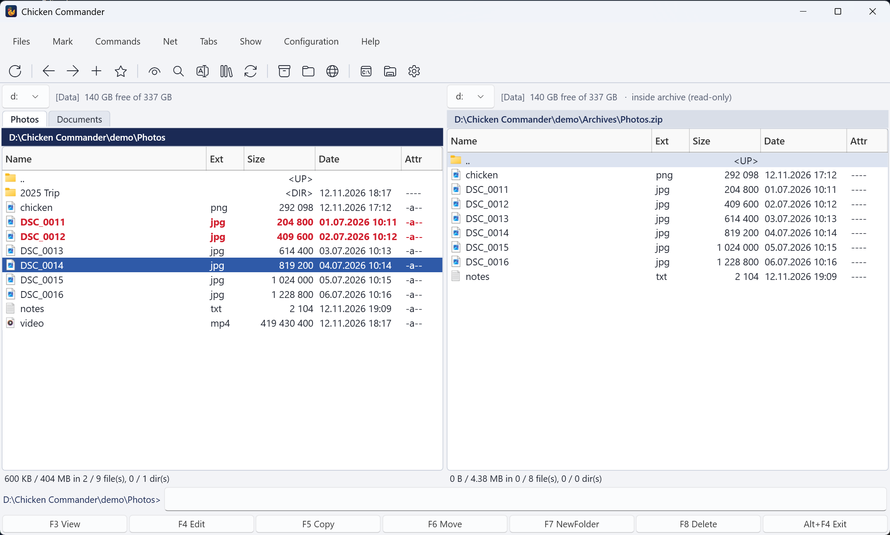
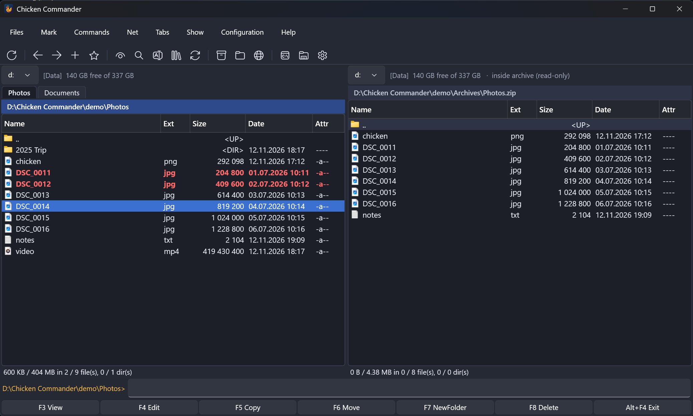

<p align="center">
  
</p>

<h1 align="center">Chicken Commander</h1>

<p align="center">
  A fast, keyboard-driven, dual-pane file manager for Windows.<br/>
  Built with C# / WPF on .NET 10, inspired by classic orthodox file managers.
</p>

<p align="center">
  
  
  
  <a href="https://github.com/luciangrozea/chicken-commander/actions/workflows/build.yml"></a>
</p>

<p align="center">
  <a href="https://github.com/luciangrozea/chicken-commander/releases/latest"><b>⬇ Download the latest release</b></a>
  — installer (<code>ChickenCommander-Setup-x.y.z.exe</code>) or portable single file (<code>ChickenCommander.exe</code>)
</p>

<p align="center">
  
</p>
<p align="center">
  
</p>

---

## Install

- **Installer**: run `ChickenCommander-Setup-x.y.z.exe`. It installs for your user without admin rights (or for all users),
  adds a Start menu entry and, if you want, a desktop icon. Uninstall from Windows Settings → Apps.
- **Portable**: download `ChickenCommander.exe` and run it from anywhere. No .NET runtime needed.

Settings are stored in `%AppData%\ChickenCommander\settings.json` and kept when you uninstall.

> The executables are not code-signed, so Windows SmartScreen may warn the first time: choose **More info → Run anyway**.

## Features

**Panels & navigation**
- Two side-by-side panels with drive selector, free space, editable path bar and status line
- **Folder tabs** in each panel: close one with its `×`, a middle-click or `Ctrl+W`; right-click a tab to close it, close the others or duplicate it. Tabs, panels, window size and hotlist are remembered between sessions
- **Back / forward history** per tab and a recent-folders menu
- **Directory hotlist** for favourite folders
- Keyboard first: everything works without a mouse (see shortcuts below)
- Smart sorting: folders first, natural order (`file2` before `file10`), click headers to sort

**File operations**
- **Own copy / move engine** running in the background: a queue of jobs with per-file and total progress, speed, time left, pause / resume and cancel
- Conflict handling: overwrite, skip, overwrite older, rename (keep both), each also "for all"
- Same-volume moves are instant renames; timestamps and attributes are preserved; half-written files are never left behind
- **Multi-Rename tool** with live preview: masks (`[N]`, `[N1-3]`, `[E]`, `[C]` counter, `[YMD]`, `[P]`…), search & replace with regex, case conversion, collision detection, undo
- **Attributes dialog**: read-only / archive / hidden / system (three-state for mixed selections), modification date, recursive
- Delete to Recycle Bin or permanently, new folder, rename in place

**Tools**
- **Built-in viewer** (`F3`): text with encoding detection (UTF-8/16/32, BOM, Latin-1), hex, and images; opens multi-GB files instantly by reading only the visible lines; find, word wrap, next/previous file
- **Quick View panel** (`Ctrl+Q`): the other panel previews whatever is under the cursor
- **Find files** (`Alt+F7`): name masks, containing text (with line preview), size and date filters, subfolders, hidden files; results stream in while searching
- **Compare by content**: side-by-side line diff (Myers algorithm) with ignore case / whitespace and jump between differences; binary files report the first differing byte
- **Synchronize directories**: compare two trees by date, size or content, review and change each action (→ / ← / skip), then copy

**Archives & network**
- **Archives as folders**: press `Enter` on a ZIP, 7z, RAR, TAR, TAR.GZ / TGZ, BZ2 or XZ file to browse it; `F5` extracts the selection, `F3` views a file inside; `..` goes back out
- **Pack** (`Alt+F5`) into ZIP, TAR or TAR.GZ and **unpack** (`Alt+F9`) whole archives, both in the background queue; protected against “zip slip” paths
- **FTP, FTPS and SFTP client** (`Ctrl+N`): saved connections, password or private-key login, browse servers in a panel, `F5` / `F6` to download or upload (folders too), `F7` / `F8` / `Shift+F6` on the server
- Secure by default: SSH host keys are confirmed on first use and checked afterwards; untrusted TLS certificates need an explicit OK; saved passwords are encrypted with Windows DPAPI
- **Checksums**: create MD5 / SHA-1 / SHA-256 / SHA-512 / CRC32 (SFV) files and verify them (GNU, BSD and SFV formats)

**Customization**
- **Light and dark themes**, or follow the Windows setting; built on WPF's Fluent theme
- **Every shortcut can be changed** (Settings → Keyboard): press the new key combination, conflicts are shown; menus and the F1 list update themselves
- **Button bar** with icons for any command, plus your own programs with parameters (`%P` folder, `%N` name, `%F` full path, `%S` marked files, `%T` other panel)
- File list font size, Recycle Bin and delete-confirmation preferences

**Marking & command line**
- Insert / Space, mark by mask (`*.txt;*.md | *.bak`), invert, select all
- Built-in command line: start typing anywhere and press Enter; `cd` navigates the active panel

## Keyboard shortcuts

| Key | Action | Key | Action |
|---|---|---|---|
| `Tab` | Switch panel | `F3` | View |
| `Enter` | Open folder / run file | `F4` | Edit |
| `Backspace` | Parent folder | `F5` | Copy |
| `Ctrl+\` | Drive root | `F6` | Move / rename |
| `Alt+F1` / `Alt+F2` | Choose drive | `Shift+F6` | Rename in place |
| `Ctrl+L` | Edit path | `F7` | New folder |
| `Insert` / `Space` | Mark item | `F8` / `Del` | Delete (Recycle Bin) |
| `Num +` / `Num -` | Mark / unmark by mask | `Shift+Del` | Delete permanently |
| `Num *` | Invert marks | `Ctrl+R` | Refresh |
| `Ctrl+A` / `Ctrl+Shift+A` | Mark / unmark all | `Ctrl+H` | Show hidden files |
| `Ctrl+Enter` | Name → command line | `Ctrl+U` | Swap panels |
| `Esc` | Clear command line | `Ctrl+E` | Target = source |
| `Ctrl+T` / `Ctrl+W` | New / close tab | `Ctrl+M` | Multi-Rename tool |
| `Ctrl+Tab` | Next tab (`Shift`: previous) | `Ctrl+I` | Change attributes |
| `Ctrl+Up` | Open folder in new tab | `Ctrl+D` | Directory hotlist |
| `Alt+Left` / `Alt+Right` | Back / forward | `Alt+Down` | Folder history |
| `Ctrl+Shift+O` | File operations window | `Ctrl+Q` | Quick View panel |
| `Alt+F7` | Find files | `Ctrl+Shift+C` | Compare by content |
| `Ctrl+Shift+S` | Synchronize directories | `Home` / `End` | First / last item |
| `Alt+F5` | Pack | `Alt+F9` | Unpack |
| `Ctrl+PgDn` | Open archive | `Ctrl+N` / `Ctrl+Shift+N` | Connect / disconnect server |
| `Ctrl+,` | Settings | `F1` | Current shortcuts |

These are the defaults; all of them can be changed in Settings → Keyboard.

In the viewer: `1` / `2` / `3` text / hex / image, `W` wrap, `Ctrl+F` find, `F3` find next, `N` / `P` next / previous file, `Esc` close.

## Roadmap

- [x] **v0.1 – Core**: dual panels, navigation, marking, shell file operations, command line
- [x] **v0.2 – Operations**: own copy/move engine with background queue and progress, multi-rename tool, folder tabs, directory history and hotlist, file attributes dialog, saved settings
- [x] **v0.3 – Tools**: built-in viewer (text / hex / image), file search, compare by content, synchronize directories, quick view panel
- [x] **v0.4 – Archives & network**: browse ZIP / 7z / RAR / TAR like folders, pack / unpack, FTP / FTPS / SFTP client, checksums
- [x] **v1.0 – Polish**: settings dialog, light / dark themes, customizable shortcuts and button bar, installer

Ideas for later: adding files to existing archives, creating 7z archives, asynchronous server listings,
more languages for the interface, file associations and an Explorer context-menu entry.

## Building

Requirements: Windows 10/11 and the [.NET 10 SDK](https://dotnet.microsoft.com/download).

```bash
dotnet build
dotnet test
dotnet run --project src/ChickenCommander
```

The FTP / SFTP integration tests talk to real servers and are skipped unless enabled. To run them, start the
local test servers (FTP on port 2121, SFTP on 2222, test user `demo` / `demo`, localhost only) and set the variable:

```bash
pip install pyftpdlib asyncssh
python tools/test_servers.py demo/Server
```

```bash
CC_TEST_SERVERS=1 dotnet test
```

The served folder needs a `pub` subfolder containing a `welcome.txt` file.

Publish a single self-contained executable:

```bash
dotnet publish src/ChickenCommander -c Release -r win-x64 --self-contained -p:PublishSingleFile=true -p:IncludeNativeLibrariesForSelfExtract=true -o publish
```

Then build the installer with [Inno Setup 6](https://jrsoftware.org/isinfo.php) (the CI does both on every push):

```bash
ISCC.exe /DAppVersion=1.0.0 installer/ChickenCommander.iss
```

## Project structure

```
src/
  ChickenCommander.Core/   UI-independent logic (unit tested)
    FileSystem/            Directory listing, sorting, masks, paths, navigation history
    Operations/            Copy/move engine, multi-rename, attributes
    Settings/              JSON settings store, shortcut map, button bar model
    Remote/                FTP / FTPS (FluentFTP) and SFTP (SSH.NET) clients, sessions, transfers
    Tools/                 File search, text diff, directory sync, checksums
    Viewer/                Encoding detection, line-indexed file reader, hex formatting
    Vfs/                   Virtual file system: local disk, archives (SharpCompress), servers
  ChickenCommander/        WPF app (MVVM with CommunityToolkit.Mvvm)
    Commands/              Command registry (shortcuts, button bar icons) and key names
    Themes/                Light / dark colour dictionaries and the theme switcher
    ViewModels/            Panel and main window state, commands
    Viewer/                Viewer control (text / hex / image) and Lister window
    Views/                 File panel control, dialogs, search / compare / sync windows
    Services/              Operation queue, Windows shell interop (icons, delete to Recycle Bin)
tests/
  ChickenCommander.Core.Tests/
installer/
  ChickenCommander.iss     Inno Setup script (per-user or all-users install, desktop icon option)
tools/
  make_icon.py             Generates the .ico / .png from the logo artwork
  test_servers.py          Local FTP + SFTP servers for the integration tests
```

## Disclaimer

Chicken Commander is an independent project. It is not affiliated with or endorsed by the authors of any
other file manager; it only follows the well-known dual-pane, keyboard-centric workflow.

## License

[MIT](LICENSE)
